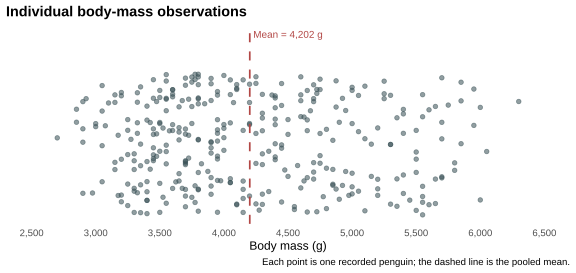
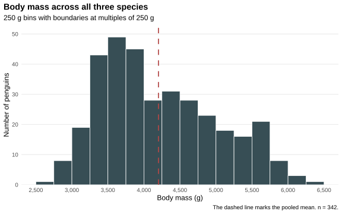
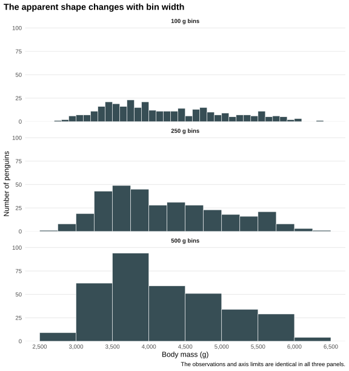
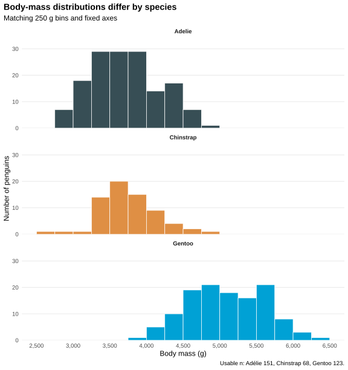
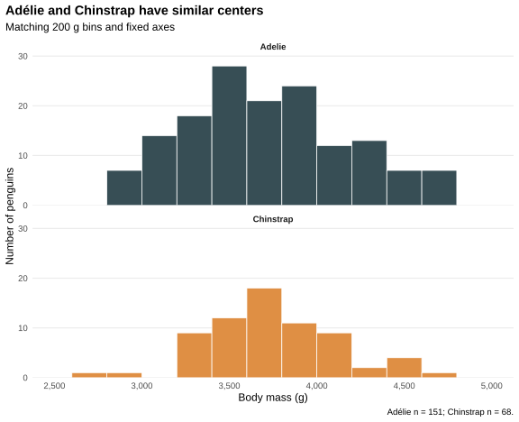
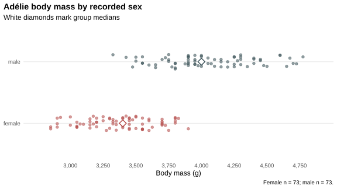
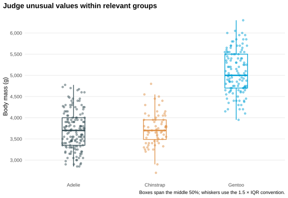
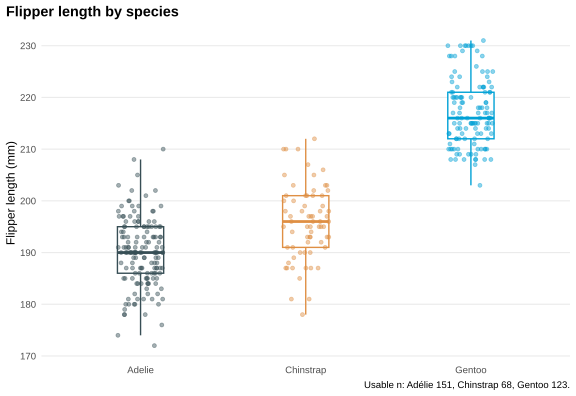

```{r document-setup, include=FALSE, purl=FALSE}
knitr::opts_chunk$set(
  warning = FALSE,
  message = FALSE,
  collapse = TRUE,
  comment = "#>",
  fig.retina = 2,
  out.width = "100%"
)
```

```{r analysis-setup, include=FALSE}
library(tidyverse)
library(palmerpenguins)

dir.create("figures", showWarnings = FALSE, recursive = TRUE)

species_colours <- c(
  "Adelie" = "#374E55",
  "Chinstrap" = "#DF8F44",
  "Gentoo" = "#00A1D5"
)

sex_colours <- c(
  "female" = "#B24745",
  "male" = "#374E55"
)

theme_penguin <- theme_minimal(base_size = 12) +
  theme(
    plot.background = element_rect(fill = "white", colour = NA),
    panel.background = element_rect(fill = "white", colour = NA),
    panel.grid.minor = element_blank(),
    panel.grid.major.x = element_blank(),
    plot.title.position = "plot",
    plot.caption.position = "plot",
    plot.title = element_text(face = "bold"),
    strip.text = element_text(face = "bold"),
    legend.position = "bottom"
  )
```

Across all penguins with a recorded body mass, the average is about **4,202 g**.

```{r opening-average}
overall_mean <- penguins |>
  summarise(
    usable_n = sum(!is.na(body_mass_g)),
    mean_body_mass_g = mean(body_mass_g, na.rm = TRUE)
  )

knitr::kable(overall_mean, digits = 2)
```

Before looking further, make a prediction: does 4,202 g describe most of the penguins reasonably well? Write down what you expect the individual measurements to look like around that number. We will return to the prediction after separating the observations into groups.

This tutorial takes about 35 minutes. The question guiding the analysis is:

> **What do we miss when we describe a dataset with just its average?**

## What you will learn

By the end, you will be able to:

- plot individual observations before summarising them;
- describe a distribution using its center, spread, asymmetry, tails, and possible concentrations;
- check how histogram bin width affects the shape you see;
- compare distributions across groups without confusing description with causation; and
- choose a summary that answers a specific question rather than reporting a mean by default.

## Before you begin

You will need R and an editor such as RStudio. The code assumes that you can run an R script and have seen `|>`, `filter()`, `summarise()`, and `ggplot()` before. No formal statistics is required.

Install the two packages once if they are not already on your computer:

```{r install, eval=FALSE, purl=FALSE}
install.packages(c("tidyverse", "palmerpenguins"))
```

Package installation adds files to your R library. Loading makes those packages available in the current R session:

```{r load-packages}
library(tidyverse)
library(palmerpenguins)
```

You can [download the complete R script](distributions-with-penguins.R) and run it from this post's folder. It recreates every table and figure in `figures/`, then prints `sessionInfo()`.

## Meet the observations

The `penguins` data contain measurements for 344 adult foraging penguins from three species in the Palmer Archipelago, Antarctica. One row represents one penguin. We will use four columns:

- `body_mass_g`: body mass in grams;
- `species`: Adélie, Chinstrap, or Gentoo;
- `sex`: female or male where recorded; and
- `flipper_length_mm`: flipper length in millimetres.

The data were collected and made available by Dr Kristen Gorman and Palmer Station Antarctica LTER. Allison Horst, Alison Hill, and Kristen Gorman prepared the `palmerpenguins` package. The [official package documentation](https://allisonhorst.github.io/palmerpenguins/) gives the full data provenance, variable definitions, licence, and citations.

Inspect only the columns used in this tutorial:

```{r inspect-data}
relevant_penguins <- penguins |>
  select(species, body_mass_g, sex, flipper_length_mm)

relevant_penguins |>
  slice_head(n = 6) |>
  knitr::kable()
```

The fourth row in this preview has missing measurements. `NA` means that a value was not recorded; it does not mean zero. Count missing values before deciding which rows an analysis can use:

```{r missing-values}
missing_relevant <- relevant_penguins |>
  summarise(across(everything(), ~ sum(is.na(.x)))) |>
  pivot_longer(
    everything(),
    names_to = "variable",
    values_to = "missing_n"
  )

knitr::kable(missing_relevant)
```

There are two missing body masses, 11 missing sex values, and two missing flipper lengths. Species is complete. For the first part, only body mass is needed, so filter on that column and retain 342 observations. Dropping every row with an `NA` anywhere would discard valid body masses because an unrelated measurement was missing.

```{r body-mass-data}
penguin_mass <- penguins |>
  filter(!is.na(body_mass_g))

penguin_mass |>
  summarise(usable_n = n()) |>
  knitr::kable()
```

## Start with every measured body mass

Where are the 342 measurements relative to the mean? The horizontal positions below are the recorded values. Vertical jitter prevents identical or nearby observations from covering one another; it has no biological meaning.

```{r individual-observations, echo=c(1, 2)}
set.seed(20261023)

p_individual <- ggplot(
  penguin_mass,
  aes(x = body_mass_g, y = 0)
) +
  geom_jitter(
    height = 0.16,
    width = 0,
    size = 1.8,
    alpha = 0.55,
    colour = "#374E55"
  ) +
  geom_vline(
    xintercept = overall_mean$mean_body_mass_g,
    colour = "#B24745",
    linewidth = 0.8,
    linetype = "dashed"
  ) +
  annotate(
    "text",
    x = overall_mean$mean_body_mass_g,
    y = 0.25,
    label = "Mean = 4,202 g",
    colour = "#B24745",
    hjust = -0.05,
    size = 3.5
  ) +
  scale_x_continuous(
    limits = c(2500, 6500),
    breaks = seq(2500, 6500, by = 500),
    labels = scales::label_comma()
  ) +
  scale_y_continuous(NULL, breaks = NULL) +
  labs(
    title = "Individual body-mass observations",
    x = "Body mass (g)",
    caption = "Each point is one recorded penguin; the dashed line is the pooled mean."
  ) +
  theme_penguin

ggsave(
  "figures/individual-body-mass.svg",
  p_individual,
  width = 8,
  height = 3.8,
  bg = "white"
)
```

```{r show-individual-observations, echo=FALSE, purl=FALSE, fig.cap="Individual body-mass observations with the pooled mean marked by a dashed line.", fig.alt="A jitter plot of 342 penguin body masses spread from 2700 to 6300 grams. A dashed vertical line marks the mean at 4202 grams."}

```

`body_mass_g` is a **variable**: a characteristic recorded for each penguin. Its **distribution** is the pattern formed by all 342 observed values, including where they concentrate, how far they spread, and whether one side extends farther than the other.

The point plot already shows why the mean is incomplete. Values span 2,700 to 6,300 g, and they do not form a tight, symmetric cloud around 4,202 g. Try changing `height = 0.16` to `height = 0`. The data stay the same, but overlapping points become harder to count.

## Put nearby values into histogram bins

A histogram groups a numeric variable into intervals. With a 250 g bin width, the bar from 3,500 up to but not including 3,750 g counts penguins in that interval. The x-axis measures body mass; the y-axis measures the number of observations in each bin.

```{r pooled-histogram, echo=1}
p_histogram <- ggplot(penguin_mass, aes(x = body_mass_g)) +
  geom_histogram(
    binwidth = 250,
    boundary = 0,
    closed = "left",
    fill = "#374E55",
    colour = "white",
    linewidth = 0.35
  ) +
  geom_vline(
    xintercept = overall_mean$mean_body_mass_g,
    colour = "#B24745",
    linewidth = 0.8,
    linetype = "dashed"
  ) +
  coord_cartesian(xlim = c(2500, 6500)) +
  scale_x_continuous(
    breaks = seq(2500, 6500, by = 500),
    labels = scales::label_comma()
  ) +
  scale_y_continuous(expand = expansion(mult = c(0, 0.08))) +
  labs(
    title = "Body mass across all three species",
    subtitle = "250 g bins with boundaries at multiples of 250 g",
    x = "Body mass (g)",
    y = "Number of penguins",
    caption = "The dashed line marks the pooled mean. n = 342."
  ) +
  theme_penguin

ggsave(
  "figures/pooled-histogram.svg",
  p_histogram,
  width = 8,
  height = 5,
  bg = "white"
)

ggsave(
  "featured.png",
  p_histogram + theme(legend.position = "none"),
  width = 8,
  height = 4.5,
  dpi = 200,
  bg = "white"
)
```

```{r show-pooled-histogram, echo=FALSE, purl=FALSE, fig.cap="A histogram of body mass for all measured penguins.", fig.alt="Histogram of penguin body masses using 250 gram bins. Counts are highest between roughly 3250 and 4000 grams and continue unevenly to 6300 grams. The pooled mean is 4202 grams."}

```

The highest counts occur between about 3,250 and 4,000 g. Counts then decline unevenly, and measurements continue through 6,300 g. The heavier side extends farther from the main lower-mass concentration than the lighter side, so the pooled distribution is asymmetric. There may be more than one concentration of values, but a single histogram is not enough to declare distinct modes or a theoretical distribution such as the normal distribution.

### Change the bin width without changing the data

Does that description survive a different bin width? The next code calculates aligned bins at 100, 250, and 500 g. All panels use the same observations, x-axis limits, and zero-based boundaries.

```{r compare-bin-widths, echo=1:3}
bin_widths <- tibble(
  bin_width = c(100, 250, 500),
  panel = factor(
    c("100 g bins", "250 g bins", "500 g bins"),
    levels = c("100 g bins", "250 g bins", "500 g bins")
  )
)

mass_bins <- tidyr::expand_grid(
  penguin_mass |> select(body_mass_g),
  bin_widths
) |>
  mutate(
    bin_left = floor(body_mass_g / bin_width) * bin_width
  ) |>
  count(panel, bin_width, bin_left, name = "count")

p_bin_widths <- ggplot(mass_bins) +
  geom_rect(
    aes(
      xmin = bin_left,
      xmax = bin_left + bin_width,
      ymin = 0,
      ymax = count
    ),
    fill = "#374E55",
    colour = "white",
    linewidth = 0.25
  ) +
  facet_wrap(~ panel, ncol = 1) +
  coord_cartesian(xlim = c(2500, 6500)) +
  scale_x_continuous(
    breaks = seq(2500, 6500, by = 500),
    labels = scales::label_comma()
  ) +
  scale_y_continuous(expand = expansion(mult = c(0, 0.08))) +
  labs(
    title = "The apparent shape changes with bin width",
    x = "Body mass (g)",
    y = "Number of penguins",
    caption = "The observations and axis limits are identical in all three panels."
  ) +
  theme_penguin

ggsave(
  "figures/bin-width-comparison.svg",
  p_bin_widths,
  width = 8,
  height = 8.5,
  bg = "white"
)
```

```{r show-bin-width-comparison, echo=FALSE, purl=FALSE, fig.cap="The same body-mass observations shown with three histogram bin widths.", fig.alt="Three vertically aligned histograms of the same penguin body masses using 100, 250, and 500 gram bins. Fine bins look jagged; broad bins smooth over local variation."}

```

The 100 g version is jagged because small changes in counts are visible. The 500 g version suppresses much of that local variation. The broad pattern—many observations below 4,000 g and a substantial set of heavier observations—persists, but the prominence and location of individual peaks change.

Modify `bin_widths` to compare 200 and 400 g. If a feature disappears when the bin width moves slightly, treat it as uncertain rather than as a stable property of the data.

## Describe center and spread together

Use several summaries on the pooled observations before adding groups:

```{r pooled-summary}
pooled_summary <- penguin_mass |>
  summarise(
    usable_n = n(),
    mean_g = mean(body_mass_g),
    median_g = median(body_mass_g),
    sd_g = sd(body_mass_g),
    q1_g = quantile(body_mass_g, 0.25),
    q3_g = quantile(body_mass_g, 0.75),
    iqr_g = IQR(body_mass_g),
    min_g = min(body_mass_g),
    max_g = max(body_mass_g)
  )

knitr::kable(pooled_summary, digits = 1)
```

The mean, 4,201.8 g, is the balance point of the observed values. The median is 4,050 g: half the measured penguins fall below it and half above it. The higher mean is consistent with heavier observations pulling the balance point to the right.

The first and third quartiles are 3,550 and 4,750 g. Their difference, the interquartile range (IQR), is 1,200 g and covers the middle half of the measurements. The standard deviation (SD) is 802.0 g; it describes the scale of variation among individual body masses around their mean. It does **not** measure uncertainty in the estimated mean. Questions about uncertainty require another quantity, such as a standard error or confidence interval, and assumptions about how the observations were sampled.

## Separate the species

The pooled histogram combines three species. Do their distributions occupy the same part of the scale? Use the same 250 g bins and fixed axes so bar heights and positions remain comparable.

```{r species-histograms, echo=1}
p_species_histograms <- ggplot(
  penguin_mass,
  aes(x = body_mass_g, fill = species)
) +
  geom_histogram(
    binwidth = 250,
    boundary = 0,
    closed = "left",
    colour = "white",
    linewidth = 0.35,
    show.legend = FALSE
  ) +
  facet_wrap(~ species, ncol = 1) +
  coord_cartesian(xlim = c(2500, 6500), ylim = c(0, 32)) +
  scale_x_continuous(
    breaks = seq(2500, 6500, by = 500),
    labels = scales::label_comma()
  ) +
  scale_y_continuous(expand = expansion(mult = c(0, 0.08))) +
  scale_fill_manual(values = species_colours) +
  labs(
    title = "Body-mass distributions differ by species",
    subtitle = "Matching 250 g bins and fixed axes",
    x = "Body mass (g)",
    y = "Number of penguins",
    caption = "Usable n: Adélie 151, Chinstrap 68, Gentoo 123."
  ) +
  theme_penguin

ggsave(
  "figures/body-mass-by-species.svg",
  p_species_histograms,
  width = 8,
  height = 8.5,
  bg = "white"
)
```

```{r show-species-histograms, echo=FALSE, purl=FALSE, fig.cap="Body-mass histograms separated by species with matching bins and axes.", fig.alt="Three vertically aligned histograms show Adélie and Chinstrap masses centered near 3700 grams and Gentoo masses centered near 5000 grams. The axes and 250 gram bins match."}

```

Gentoo observations are shifted toward higher masses. Adélie and Chinstrap occupy similar ranges and have similar centers. Combining them with Gentoo produces much of the uneven structure in the pooled histogram. The pooled mean of 4,202 g falls between the Gentoo center and the centers of the other two species, so it is not especially representative of any one species.

Now calculate the same summaries within species. Because `penguin_mass` was filtered only for body mass, this comparison uses every row that has the measurement it needs.

```{r species-summary}
species_summary <- penguin_mass |>
  group_by(species) |>
  summarise(
    usable_n = n(),
    mean_g = mean(body_mass_g),
    median_g = median(body_mass_g),
    sd_g = sd(body_mass_g),
    q1_g = quantile(body_mass_g, 0.25),
    q3_g = quantile(body_mass_g, 0.75),
    iqr_g = IQR(body_mass_g),
    .groups = "drop"
  )

knitr::kable(species_summary, digits = 1)
```

Each column answers a different descriptive question. `usable_n` records how many penguins contributed. The mean and median locate the center. SD describes spread around the mean, while the quartiles and IQR describe the middle half without depending strongly on the most extreme observations.

Gentoo has a mean of 5,076.0 g and a median of 5,000 g. The corresponding centers are 3,700.7 and 3,700 g for Adélie, and 3,733.1 and 3,700 g for Chinstrap. The IQRs—650, 462.5, and 800 g—also show that the amount of within-species spread differs. Change `group_by(species)` to `group_by(island)` as a quick modification, but remember that species and island are not independent in these data.

## Similar means can accompany different spreads

Adélie and Chinstrap provide a useful comparison because their means differ by only 32.4 g and both medians are 3,700 g. Start from the summaries rather than assuming the plots will show a dramatic contrast.

```{r adelie-chinstrap-summary}
adelie_chinstrap_summary <- species_summary |>
  filter(species %in% c("Adelie", "Chinstrap"))

knitr::kable(adelie_chinstrap_summary, digits = 1)
```

```{r adelie-chinstrap-plot, echo=1:2}
adelie_chinstrap <- penguin_mass |>
  filter(species %in% c("Adelie", "Chinstrap"))

p_adelie_chinstrap <- ggplot(
  adelie_chinstrap,
  aes(x = body_mass_g, fill = species)
) +
  geom_histogram(
    binwidth = 200,
    boundary = 0,
    closed = "left",
    colour = "white",
    linewidth = 0.35,
    show.legend = FALSE
  ) +
  facet_wrap(~ species, ncol = 1) +
  coord_cartesian(xlim = c(2500, 5000), ylim = c(0, 28)) +
  scale_x_continuous(
    breaks = seq(2500, 5000, by = 500),
    labels = scales::label_comma()
  ) +
  scale_y_continuous(expand = expansion(mult = c(0, 0.08))) +
  scale_fill_manual(values = species_colours) +
  labs(
    title = "Adélie and Chinstrap have similar centers",
    subtitle = "Matching 200 g bins and fixed axes",
    x = "Body mass (g)",
    y = "Number of penguins",
    caption = "Adélie n = 151; Chinstrap n = 68."
  ) +
  theme_penguin

ggsave(
  "figures/adelie-chinstrap-comparison.svg",
  p_adelie_chinstrap,
  width = 8,
  height = 6.5,
  bg = "white"
)
```

```{r show-adelie-chinstrap-plot, echo=FALSE, purl=FALSE, fig.cap="Histograms comparing Adélie and Chinstrap body mass.", fig.alt="Two aligned histograms show strongly overlapping Adélie and Chinstrap body-mass distributions. Adélie has more observations and a somewhat wider spread."}

```

The two distributions overlap substantially. Adélie has the larger SD (458.6 versus 384.3 g) and IQR (650 versus 462.5 g), indicating somewhat greater spread in these observations. The different sample sizes also affect how smooth and tall the histograms look, so bar height alone should not be read as evidence that one population is more variable.

Before continuing, predict what will happen if Adélie penguins are separated by sex. Will the two centers remain close, and will their ranges overlap?

## Add sex within Adélie penguins

First account for missingness. The dataset contains 152 Adélie rows; six have no recorded sex and one has no body mass. Requiring both variables leaves 146 observations.

```{r adelie-missingness}
adelie_missingness <- penguins |>
  filter(species == "Adelie") |>
  summarise(
    total_rows = n(),
    missing_body_mass = sum(is.na(body_mass_g)),
    missing_sex = sum(is.na(sex)),
    usable_for_comparison = sum(
      !is.na(body_mass_g) & !is.na(sex)
    )
  )

knitr::kable(adelie_missingness)
```

Filter on both variables only now, when the analysis needs both:

```{r adelie-sex-summary}
adelie_sex <- penguins |>
  filter(
    species == "Adelie",
    !is.na(body_mass_g),
    !is.na(sex)
  )

adelie_sex_summary <- adelie_sex |>
  group_by(sex) |>
  summarise(
    usable_n = n(),
    mean_g = mean(body_mass_g),
    median_g = median(body_mass_g),
    min_g = min(body_mass_g),
    max_g = max(body_mass_g),
    .groups = "drop"
  )

knitr::kable(adelie_sex_summary, digits = 1)
```

```{r adelie-sex-plot, echo=c(1, 2)}
set.seed(20261023)

p_adelie_sex <- ggplot(
  adelie_sex,
  aes(x = body_mass_g, y = sex, colour = sex)
) +
  geom_jitter(
    height = 0.12,
    width = 0,
    alpha = 0.55,
    size = 1.8,
    show.legend = FALSE
  ) +
  stat_summary(
    fun = median,
    geom = "point",
    shape = 23,
    size = 3.8,
    fill = "white",
    stroke = 1,
    show.legend = FALSE
  ) +
  scale_colour_manual(values = sex_colours) +
  scale_x_continuous(
    limits = c(2750, 4900),
    breaks = seq(3000, 4750, by = 250),
    labels = scales::label_comma()
  ) +
  labs(
    title = "Adélie body mass by recorded sex",
    subtitle = "White diamonds mark group medians",
    x = "Body mass (g)",
    y = NULL,
    caption = "Female n = 73; male n = 73."
  ) +
  theme_penguin

ggsave(
  "figures/adelie-body-mass-by-sex.svg",
  p_adelie_sex,
  width = 8,
  height = 4.5,
  bg = "white"
)
```

```{r show-adelie-sex-plot, echo=FALSE, purl=FALSE, fig.cap="Individual Adélie body masses separated by recorded sex.", fig.alt="Two horizontal jittered rows compare Adélie body mass by recorded sex. Female observations center near 3400 grams and male observations near 4000 grams, with overlap from about 3325 to 3900 grams."}

```

The female and male groups each contain 73 observations. Their means are 3,368.8 and 4,043.5 g, and their medians differ by 600 g. The observed ranges overlap between 3,325 and 3,900 g, so recorded sex does not determine the mass of an individual penguin. These are descriptive comparisons from an observational dataset; they do not by themselves establish what caused the difference.

Species corresponds to the largest separation in the pooled body-mass plot. Within Adélie penguins, the distributions also shift by recorded sex.

## Check unusual measurements in context

A boxplot gives a compact view of medians, quartiles, and values beyond the whiskers. Overlay the observations so the summary does not hide the sample sizes or repeated measurements.

```{r unusual-values-plot, echo=c(1, 2)}
set.seed(20261023)

p_unusual <- ggplot(
  penguin_mass,
  aes(x = species, y = body_mass_g, colour = species)
) +
  geom_boxplot(
    width = 0.28,
    outlier.shape = NA,
    fill = "white",
    linewidth = 0.65,
    show.legend = FALSE
  ) +
  geom_jitter(
    width = 0.14,
    height = 0,
    alpha = 0.45,
    size = 1.5,
    show.legend = FALSE
  ) +
  scale_colour_manual(values = species_colours) +
  scale_y_continuous(
    breaks = seq(2500, 6500, by = 500),
    labels = scales::label_comma()
  ) +
  labs(
    title = "Judge unusual values within relevant groups",
    x = NULL,
    y = "Body mass (g)",
    caption = "Boxes span the middle 50%; whiskers use the 1.5 × IQR convention."
  ) +
  theme_penguin

ggsave(
  "figures/unusual-values-by-species.svg",
  p_unusual,
  width = 8,
  height = 5.5,
  bg = "white"
)
```

```{r show-unusual-values-plot, echo=FALSE, purl=FALSE, fig.cap="Boxplots and individual body masses for each species.", fig.alt="Boxplots with overlaid points show Gentoo penguins shifted to higher body masses than Adélie and Chinstrap. Two Chinstrap points lie beyond their group's boxplot whiskers."}

```

Values of 5,500 g or more may look unusual relative to the pooled mean. Count them by species before deciding how to interpret them:

```{r high-mass-count}
high_mass_by_species <- penguin_mass |>
  filter(body_mass_g >= 5500) |>
  count(species, name = "n_at_least_5500_g")

knitr::kable(high_mass_by_species)
```

All 33 are Gentoo, and 5,500 g is the Gentoo third quartile. They belong to the upper quarter of a heavier species rather than forming automatic errors.

Under the usual 1.5 × IQR rule, two Chinstrap observations fall beyond the species-specific boxplot whiskers:

```{r boxplot-rule}
species_boxplot_flags <- penguin_mass |>
  group_by(species) |>
  mutate(
    q1_g = quantile(body_mass_g, 0.25),
    q3_g = quantile(body_mass_g, 0.75),
    iqr_g = q3_g - q1_g
  ) |>
  filter(
    body_mass_g < q1_g - 1.5 * iqr_g |
      body_mass_g > q3_g + 1.5 * iqr_g
  ) |>
  select(species, body_mass_g)

knitr::kable(species_boxplot_flags)
```

The rule marks 2,700 and 4,800 g for review. A whisker is a plotting convention, not a biological boundary or a deletion instruction. Check the original record, measurement procedure, and scientific context before excluding any observation. Keeping a valid extreme value is often necessary to describe the observed variation accurately.

## Independent exercise: flipper length

Apply the same sequence to `flipper_length_mm` without copying the interpretation from body mass.

1. Predict which species will have the longest typical flippers and whether within-species spread will differ much.
2. Filter only rows missing flipper length.
3. Plot individual observations by species with matching axes.
4. Calculate usable n, mean, median, SD, quartiles, and IQR by species.
5. Write two sentences: one about the group centers and one about spread.

Start with this scaffold:

```{r flipper-exercise-scaffold, eval=FALSE, purl=FALSE}
flipper_data <- penguins |>
  filter(!is.na(flipper_length_mm))

ggplot(
  flipper_data,
  aes(x = species, y = flipper_length_mm, colour = species)
) +
  geom_jitter(width = 0.14, height = 0)

flipper_data |>
  group_by(species) |>
  summarise(
    usable_n = n(),
    mean_mm = mean(flipper_length_mm),
    median_mm = median(flipper_length_mm),
    # Add SD, quartiles, and IQR here.
    .groups = "drop"
  )
```

<details>
<summary><strong>Worked answer</strong></summary>

```{r flipper-worked-answer}
flipper_data <- penguins |>
  filter(!is.na(flipper_length_mm))

flipper_summary <- flipper_data |>
  group_by(species) |>
  summarise(
    usable_n = n(),
    mean_mm = mean(flipper_length_mm),
    median_mm = median(flipper_length_mm),
    sd_mm = sd(flipper_length_mm),
    q1_mm = quantile(flipper_length_mm, 0.25),
    q3_mm = quantile(flipper_length_mm, 0.75),
    iqr_mm = IQR(flipper_length_mm),
    .groups = "drop"
  )

knitr::kable(flipper_summary, digits = 1)
```

```{r flipper-worked-plot, echo=c(1, 2)}
set.seed(20261023)

p_flipper <- ggplot(
  flipper_data,
  aes(x = species, y = flipper_length_mm, colour = species)
) +
  geom_boxplot(
    width = 0.28,
    outlier.shape = NA,
    fill = "white",
    linewidth = 0.65,
    show.legend = FALSE
  ) +
  geom_jitter(
    width = 0.14,
    height = 0,
    alpha = 0.45,
    size = 1.5,
    show.legend = FALSE
  ) +
  scale_colour_manual(values = species_colours) +
  scale_y_continuous(breaks = seq(170, 235, by = 10)) +
  labs(
    title = "Flipper length by species",
    x = NULL,
    y = "Flipper length (mm)",
    caption = "Usable n: Adélie 151, Chinstrap 68, Gentoo 123."
  ) +
  theme_penguin

ggsave(
  "figures/flipper-length-by-species.svg",
  p_flipper,
  width = 8,
  height = 5.5,
  bg = "white"
)
```

```{r show-flipper-worked-plot, echo=FALSE, purl=FALSE, fig.cap="Flipper-length observations and boxplots by species.", fig.alt="Boxplots with individual points show Gentoo flipper lengths centered near 216 millimetres, Chinstrap near 196 millimetres, and Adélie near 190 millimetres. Within-species spreads are similar."}

```

Gentoo penguins have the longest flippers in these observations (mean 217.2 mm; median 216 mm), followed by Chinstrap (195.8; 196 mm) and Adélie (190.0; 190 mm). Within-species SDs are similar at 6.5–7.1 mm and IQRs are 9–10 mm, so the separation in group centers—especially for Gentoo—is large relative to the spread within each species.

</details>

## Return to the average

The pooled mean of 4,202 g did not describe most penguins particularly well. Body mass covered a 3,600 g range, the pooled distribution was asymmetric, and the mean sat between a heavier Gentoo group and two lighter species. Within Adélie penguins, the distributions also differed by recorded sex.

The average remains useful, provided it is reported with the population being averaged, the usable sample size, and a measure of spread. A plot of the observations helps determine whether that compact summary omits structure that matters to the research question.

Possible next steps include empirical cumulative distribution functions for reading proportions below a threshold, density estimates with explicit bandwidth checks, uncertainty intervals for estimated group means, and regression models that consider several variables together. Formal distribution fitting and normality tests answer narrower questions and should follow, rather than replace, inspection of the observations and sampling design.

## Data credit

The data originate from Gorman KB, Williams TD, and Fraser WR (2014), *Ecological Sexual Dimorphism and Environmental Variability within a Community of Antarctic Penguins (Genus Pygoscelis)*, PLOS ONE 9(3): e90081, and the Palmer Station Antarctica LTER datasets listed in the [palmerpenguins documentation](https://allisonhorst.github.io/palmerpenguins/reference/penguins.html). Package citation: Horst AM, Hill AP, and Gorman KB (2020), *palmerpenguins: Palmer Archipelago (Antarctica) penguin data*, doi: [10.5281/zenodo.3960218](https://doi.org/10.5281/zenodo.3960218).

```{r session-info, include=FALSE}
sessionInfo()
```
